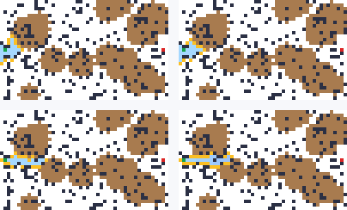
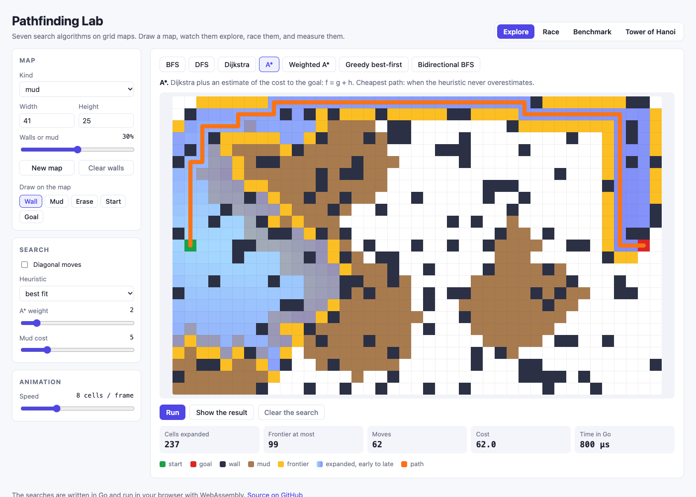
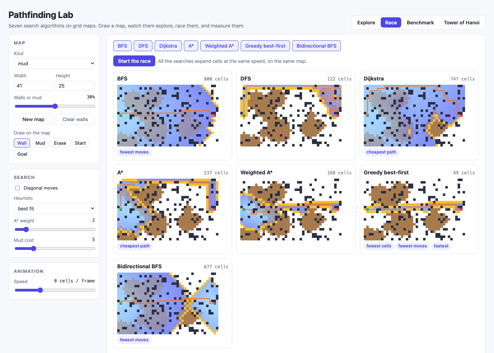
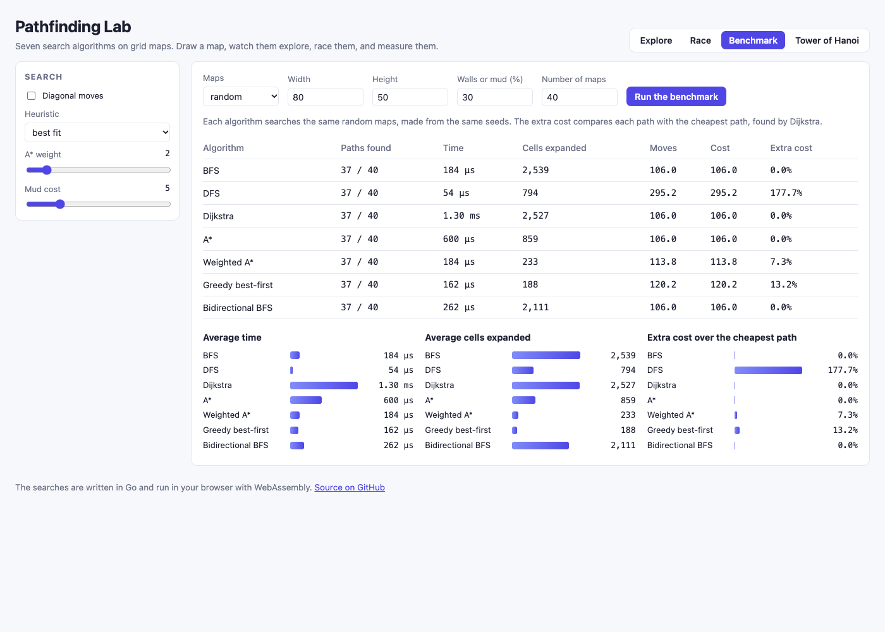

# Pathfinding Lab

Seven search algorithms on grid maps, written in Go: BFS, DFS, Dijkstra, A*, weighted A*, greedy best-first, and bidirectional BFS. A web page runs them in your browser with WebAssembly. You can draw a map, watch one search explore it, race the searches on the same map, and benchmark them on hundreds of random maps. The page also solves the Tower of Hanoi with BFS, like the first version of this project.

[](https://github.com/rahelmartim/pathfinding-lab/actions/workflows/ci.yml)
[](https://rahelmartim.github.io/pathfinding-lab/)



Top left is BFS, top right Dijkstra, bottom left A*, and bottom right greedy best-first. A* finds the cheapest path, like Dijkstra, with less than a third of the cells. To try it, open the [live demo](https://rahelmartim.github.io/pathfinding-lab/).

## The page

The page has four tabs.

| Tab | What it does |
| --- | --- |
| Explore | One search on one map, step by step: the frontier in yellow, the expanded cells from light blue (early) to indigo (late), and the path in orange. You can draw walls and mud, and move the start and the goal. |
| Race | The searches that you choose, side by side on the same map. At the end, badges show the fewest cells, the cheapest path, the fewest moves, and the fastest search. |
| Benchmark | Every search on the same random maps. A table and charts show the paths found, the time, the cells expanded, and the extra cost over the cheapest path. |
| Tower of Hanoi | BFS over the states of the game, for 1 to 10 disks, with the solution played on three rods. |





### Settings

| Setting | Values | What it changes |
| --- | --- | --- |
| Kind | random, maze, rooms, mud, empty | The kind of map that New map makes. |
| Width and height | 5 to 200 | The size of the map. |
| Walls or mud | 0 to 60% | The share of walls in a random map, or of mud in a mud map. |
| Diagonal moves | on or off | 8 neighbors instead of 4. A diagonal move costs √2, and it never cuts the corner of a wall. |
| Heuristic | Manhattan, Euclidean, octile, Chebyshev | The estimate of A*, weighted A*, and greedy best-first. "Best fit" is Manhattan without diagonals, and octile with them. |
| A* weight | 1 to 10 | The w of weighted A*: f = g + w·h. |
| Mud cost | 1 to 20 | The cost to enter a mud cell. An open cell costs 1. |
| Speed | 1 to 1024 cells | The cells that the animation expands in each frame. |

## The algorithms

| Algorithm | How it works | Cheapest path |
| --- | --- | --- |
| BFS | It explores the map in rings around the start. | Fewest moves, but it does not see the cost of mud. |
| DFS | It follows one way to its end before it tries another. | Never. Its path is often long. |
| Dijkstra | It always expands the cheapest cell so far. | Always. |
| A* | Dijkstra plus an estimate of the cost to the goal: f = g + h. | When the heuristic never overestimates. |
| Weighted A* | A* that trusts the estimate more: f = g + w·h. | No, but the cost is at most w times the cheapest cost. |
| Greedy best-first | It always goes to the cell that looks closest to the goal: f = h. | Never. |
| Bidirectional BFS | Two BFS searches, from the start and from the goal, that meet in the middle. | Fewest moves, but it does not see the cost of mud. |

Dijkstra, A*, weighted A*, and greedy best-first are one loop in `search/search.go`. Only the priority f changes.



## Getting started

You need Go 1.24 or later and Python 3.

```bash
make serve
```

Then open http://localhost:8080. To use another port, run `make serve PORT=8090`.

### In the terminal

```bash
go run ./cmd/pathfind -kind maze -width 41 -height 21    # every search, with its path
go run ./cmd/pathfind -kind mud -algorithm astar -diagonal
go run ./cmd/hanoi -disks 4                              # the Tower of Hanoi with BFS
make bench                                               # the Go benchmarks
```

In the terminal map, `#` is a wall, `~` is mud, `.` is an expanded cell, and `*` is the path.

### Use the packages

```go
m, _ := grid.Generate("maze", 41, 21, 0, 1)
r, _ := search.Run("astar", m, search.Options{Diagonal: true})
fmt.Println(r.Found, r.Steps, r.Cost, r.Expanded)
```

## Tests

```bash
make test                                   # Go tests with the race detector
make web && node --test web/test/lab.test.js  # browser tests (needs Chrome)
```

| Package | What the tests cover |
| --- | --- |
| `grid` | Every map kind is valid, and the start and the goal are open. Mazes are perfect (one path between two cells), and rooms are connected. The density, the seeds, and the checks of a map. |
| `search` | 200 random maps, with and without diagonals: every path is legal, A* costs the same as Dijkstra, weighted A* stays in its bound, and bidirectional BFS has as many moves as BFS. Mud, closed goals, corners, heuristics, and the benchmark. |
| `hanoi` | 1 to 10 disks: the solution has 2ⁿ − 1 moves, and every move follows the rules. |
| `web/test` | In a headless Chrome: a straight path on an open map, the animation, a wall drawn across the map, the race, the benchmark, and the Tower of Hanoi. |

## Project structure

```text
grid/          # The map, and the map generators
search/        # The seven algorithms, and the benchmark
hanoi/         # The Tower of Hanoi with BFS
cmd/pathfind/  # The searches in the terminal
cmd/hanoi/     # The Tower of Hanoi in the terminal
cmd/lab-wasm/  # The WebAssembly build for the page
cmd/searchgif/ # The GIF at the top of this file (make gif)
web/           # The page, and its browser tests
docs/          # Screenshots
```

## History

In 2021, this project was three Go programs about search in artificial intelligence: BFS for the Tower of Hanoi, and BFS and a greedy search on a 4 × 5 grid. In 2026, it got the grid and search packages, five more algorithms, the page, and tests. The first grid search kept a wrong parent for each cell, so its path was sometimes wrong. The new searches keep the right parent, and the tests check every path.

## License

This project uses the MIT license. Read the [LICENSE](LICENSE) file for the full text.
